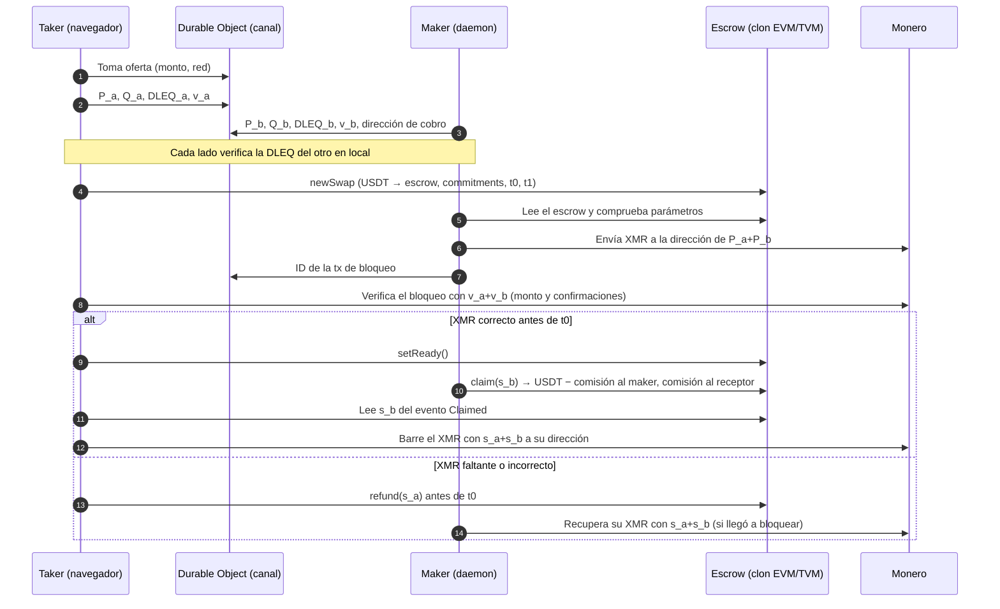
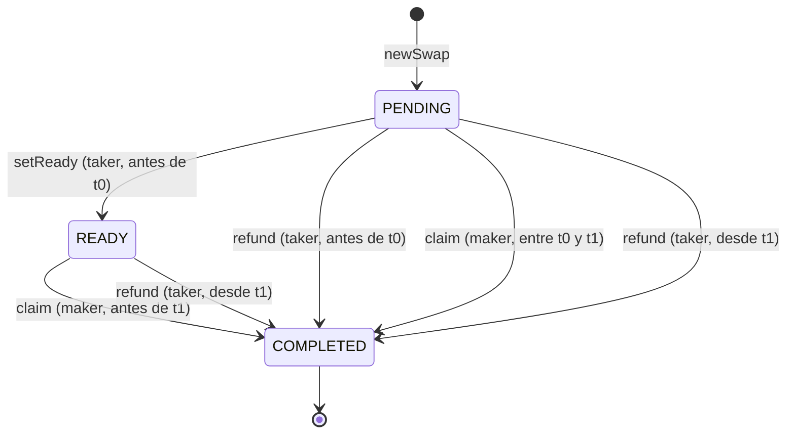

# Arquitectura de xmrp2p (Fase 0)

> Última actualización: 24 de octubre de 2026. Estado: **Fase 0 terminada; Fase 1 (contrato) implementada y probada, sin auditoría y sin desplegar**. Nada de esto está en mainnet.

**Resumen en una frase:** el protocolo de AthanorLabs adaptado a USDT es viable en el navegador con librerías existentes. Las pruebas DLEQ en WASM, el contrato con los tres comportamientos de USDT y monero-ts vía proxy funcionaron. Los dos problemas serios son que **el taker necesita estar en línea antes de t0** y que **verificar el XMR en el navegador hoy tarda ~4 minutos**.

## 1. Roles y llaves

| | Taker (navegador) | Maker (daemon) |
|---|---|---|
| Tiene / quiere | USDT / XMR | XMR / USDT |
| En el protocolo de AthanorLabs es | Alice (lado del token) | Bob (lado de Monero) |
| Genera | `s_a` (gasto), `v_a` (vista) | `s_b`, `v_b` |
| Publica | `P_a = s_a·G` (ed25519), `Q_a = s_a·G` (secp256k1), DLEQ(`P_a`,`Q_a`), `v_a` | lo mismo con `b` |
| Bloquea | USDT en un escrow propio (clon) | XMR en la dirección de `P_a + P_b` con vista `v_a + v_b` |

El mismo escalar `s` vale en las dos curvas porque se limita a 252 bits; la prueba DLEQ demuestra que `P` y `Q` comparten el mismo secreto. El contrato guarda `keccak(Q)` (claimCommitment = maker, refundCommitment = taker) y verifica el secreto con el truco de `ecrecover`. Revelar `s_b` al reclamar le da al taker la llave completa `s_a + s_b` del XMR. Revelar `s_a` al reembolsar le devuelve al maker el control del XMR.

## 2. Flujo del swap



### Máquina de estados del escrow



## 3. Decisiones técnicas

| # | Decisión | Razón |
|---|---|---|
| D1 | **Protocolo de AthanorLabs como referencia**, contrato reescrito desde cero | El repo no se mantiene desde dic-2023 y su contrato guarda todos los swaps en un solo contrato. |
| D2 | **Un escrow por swap** (clon EIP-1167 desde una fábrica sin administrador) | Si Tether congela una dirección, solo se afecta ese swap. Probado en `research/contract-compat`. |
| D3 | **Transferencias verificadas por diferencia de saldo**, no `SafeERC20` | USDT en Tron devuelve `false` en `transfer` aunque transfiera; `SafeERC20` revertiría. USDT en Ethereum no devuelve nada. Una sola librería cubre los tres casos (probado). |
| D4 | **Comisión con tope constante** en el escrow (`MAX_FEE_BPS`) y valor fijo por fábrica | Nadie puede subir la comisión después del despliegue. |
| D5 | **DLEQ: `sigma_fun` (`dl_secp256k1_ed25519_eq`)** con los puntos H de eigenwallet | Es la única DLEQ entre curvas en producción real (eigenwallet BTC↔XMR). Compila a WASM (148 KB gzip) y genera/verifica en ~0,35 s en el navegador. Ninguna alternativa está auditada (ver riesgos). |
| D6 | **Wallet Monero del taker: monero-ts para el MVP**, con evaluación de un escáner propio con `monero-oxide` en la Fase 2 | monero-ts funcionó en el navegador, pero tarda 226 s en sincronizar y pesa ~2 MB gzip. |
| D7 | **Proxy de nodos en Worker obligatorio por defecto**, nodo propio opcional | Los nodos públicos no tienen CORS ni HTTPS. El proxy tiene listas cerradas de nodos y métodos. |
| D8 | **Arbitrum primero, Tron después** | Arbitrum tiene USD₮0 con indicios de `permit`/EIP-3009 en la cadena y es EVM estándar. Tron necesita su propio solc, otra fórmula de CREATE2 y una prueba real de `ecrecover`. |
| D9 | **OpenZeppelin fijado (v5.4.0) y EVM `shanghai`** | Las versiones nuevas usan opcodes (`clz`, Osaka) que TVM no tiene. |
| D10 | **Licencia AGPL-3.0** | Quien ofrezca una versión modificada como servicio debe publicar el código. Encaja con un frontend verificable. |

## 4. Resultados de las pruebas de la Fase 0

| Prueba | Carpeta | Resultado |
|---|---|---|
| DLEQ en WASM | `research/dleq-wasm` | ✅ 3/3 pruebas nativas; en el navegador prove 353 ms y verify 320 ms; WASM de 266 KB (148 KB gzip); prueba de ~170 KB en JSON |
| Vector cruzado Rust → Solidity | `research/contract-compat` | ✅ el secreto de Rust pasa `mulVerify` en el contrato |
| Escrow + 3 comportamientos de USDT | `research/contract-compat` | ✅ 40/40 (incluye fuzzing con 1000 corridas y aislamiento por lista negra) |
| Slither | `research/contract-compat` | 8 avisos, ninguno crítico para el prototipo; se resuelven en la Fase 1 |
| Nodos públicos stagenet | `research/worker-proxy` | 4/7 responden; **0 con CORS, 0 con HTTPS** |
| Worker proxy (`fetch` y `connect` a 38081/38089) | `research/worker-proxy` | ✅ en local y ✅ **desplegado en producción** (4/4 nodos, CORS y filtros OK) |
| monero-ts en el navegador | `research/monero-ts-browser` | Directo ❌ (CORS) · vía proxy ✅ · wallet de solo vista sincronizada en 226 s (169 peticiones) |
| Tamaños vs Cloudflare Pages (25 MiB por archivo, 20 000 archivos) | — | ✅ el archivo más grande pesa 4,3 MB |
| Durable Objects en el plan gratuito | documentación | ✅ con backend SQLite; 100 000 peticiones/día; los mensajes WebSocket cuentan 20:1 |
| Tron (TVM) | documentación | Compatible en principio; falta probar `ecrecover` y los clones en Nile |

## 5. Riesgos

### Críticos (pueden hacer perder fondos)

1. **El taker debe estar en línea antes de t0.** Si el maker *no* bloquea XMR y el taker no reembolsa antes de t0, el contrato deja que el maker reclame el USDT entre t0 y t1 (comportamiento heredado de AthanorLabs; probado en `test_claimAutomatico_trasT0_sinReady`). Un maker malicioso podría esperar a que el taker cierre la pestaña. Mitigaciones a decidir:
   - (a) **Cambiar el contrato**: entre t0 y t1 el maker solo puede reclamar si el XMR está bloqueado. El contrato no puede comprobarlo, así que la alternativa real es (b) o (c).
   - (b) **t0 corto y app que no deja continuar** sin la pestaña abierta, con notificaciones y un archivo de recuperación.
   - (c) **Vigilante (watchtower)** que reembolse en nombre del taker. Hoy `refund` exige el secreto `s_a`, y dárselo a un tercero es peligroso: si el vigilante se lo pasa al maker, el maker se lleva el USDT y el XMR. Requiere rediseño y auditoría.
   - (d) **Invertir la carga**: que el maker deposite primero una fianza en USDT que pierde si no bloquea XMR.
   - **Recomendación:** (b) para el MVP en testnet y estudiar (d) en la Fase 1.
2. **El taker debe volver a barrer el XMR.** Tras `claim`, el XMR queda en la dirección compartida hasta que el taker lo mueva con `s_a + s_b`. Si pierde `s_a` (borra el navegador sin el archivo de recuperación), pierde el XMR. El archivo de recuperación es obligatorio antes de firmar el depósito.
3. **DLEQ entre curvas sin auditoría formal.** `sigma_fun` se declara experimental; la versión de Serai está bajo `experimental` y fuera de su auditoría (Cypher Stack, mar-2023); `go-dleq` no tiene auditoría conocida. Debe entrar en el alcance de la auditoría externa.
4. **Lista negra del receptor de comisión.** Si Tether congela `feeRecipient`, todos los `claim` revierten. Solución en Fase 1: la comisión se acumula y se retira aparte.

### Altos

5. **Sincronización lenta de la wallet del taker** (226 s): pone en riesgo llegar a `setReady` antes de t0. Mitigación: el maker envía el ID de la tx de bloqueo y el taker la verifica con `get_transactions` y su llave de vista, o un escáner con `monero-oxide`.
6. **Privacidad del proxy**: el Worker ve qué bloques y transacciones consulta cada IP. Hay que explicarlo y dejar elegir nodo.
7. **Opción gratuita**: entre el depósito y el reclamo, cualquiera puede abandonar si el precio se mueve. Plazos cortos, límites por trade y, si hace falta, fianzas.
8. **Gas nativo**: el taker necesita ETH en Arbitrum (o TRX/energía en Tron) además de USDT. `permit`/EIP-3009 en USD₮0 ahorra el `approve`, pero no el gas de `setReady`/`refund`.
9. **Frontend como punto de ataque**: si alguien altera el JS servido, puede robar `s_a`. Requiere CSP estricta, SRI, builds reproducibles y una copia en IPFS (Fase 5).

### Regulatorios

10. Operar el sitio y cobrar comisión puede considerarse transmisión de dinero o servicio de activos virtuales en varios países. Esto **no es asesoría legal**: conviene consultar a un abogado antes de mainnet. Por eso existen los interruptores de bloqueo por región.

## 6. Preguntas abiertas (necesitan decisión o prueba)

| # | Pregunta | Cómo se resuelve |
|---|---|---|
| A1 | ¿Qué mitigación del riesgo 1 adoptamos? | Decisión del dueño + diseño en la Fase 1 |
| ~~A2~~ | ~~¿`fetch()` a 38081 funciona en un Worker desplegado?~~ | **Resuelta (24-oct):** sí, `fetch()` y `connect()` funcionan en producción |
| A3 | ¿`ecrecover` y los clones funcionan igual en Tron Nile? | **Parcial (24-oct):** compila con el solc de Tron y la red tiene activados los opcodes necesarios. Falta un despliegue en Nile (requiere TRX de prueba del faucet, paso del dueño) |
| ~~A4~~ | ~~¿USD₮0 en Arbitrum acepta `permit()`?~~ | **Resuelta (24-oct):** sí. `newSwapWithPermit` funciona en un fork de Arbitrum One con el USD₮0 real |
| A5 | ¿Valores de t0 y t1? | Depende del tiempo de confirmación de Monero (10 bloques ≈ 20 min) y del riesgo 1 |
| A6 | ¿monero-ts o escáner propio con `monero-oxide`? | Prototipo comparativo al inicio de la Fase 2 |
| A7 | ¿Serialización compacta de la DLEQ (170 KB en JSON)? | Fase 2 |

## 7. Plan por fases (resumen)

| Fase | Entregable | Puntos clave salidos de la Fase 0 |
|---|---|---|
| 1 · Contrato ✅ | `contracts/` con Foundry: fábrica + escrow clon, 117 pruebas (unitarias, fuzz, invariantes, fork con USDT real), Slither | Implementado el 24-oct (ver `contracts/README.md`). Pendiente: tu decisión sobre el riesgo 1 (C6) y el despliegue real en Arbitrum Sepolia / Tron Nile, que necesita fondos de faucet |
| 2 · Cripto WASM | `crypto-wasm/` en Rust: llaves, DLEQ, verificación, reconstrucción y barrido | `sigma_fun`; vectores cruzados con Solidity y con AthanorLabs; serialización compacta; decidir A6 |
| 3 · Maker | `maker/` (Rust o Python) con estado persistente | Envía el ID de la tx de bloqueo; precio desde varias fuentes; límites de exposición |
| 4 · Cloudflare | `workers/`: libro de órdenes (Workers + D1), canal (Durable Objects + WebSocket), proxy de nodos | Proxy con listas cerradas y un subdominio por nodo; límites de peticiones |
| 5 · App | `web/` ruta `/app`: flujo del swap, archivo de recuperación, CSP/SRI, IPFS | El archivo de recuperación se descarga **antes** del depósito |
| 6 · Sitio y SEO | `web/` en Astro con cero JS en el contenido, robots/llms.txt, IndexNow, guías ES/EN | La API pública de cotizaciones (OpenAPI) y el servidor MCP de solo lectura viven en `workers/api` y `workers/mcp` |
| 7 · E2E testnet | `docs/PRUEBAS.md` | Todos los casos de falla, incluido el riesgo 1 |

### Estructura prevista del monorepo

```
contracts/      Foundry (src/, test/, script/)
crypto-wasm/    crate Rust → pkg/ para la web
maker/          daemon + docs para operar un maker
workers/
  orderbook/    Worker + D1
  channel/      Durable Object (WebSocket)
  node-proxy/   proxy a nodos de Monero
  api/          API pública de cotizaciones (OpenAPI)
  mcp/          servidor MCP de solo lectura
web/            Astro (contenido) + app del swap en /app
config/         xmrp2p.example.toml (fuente única de configuración)
docs/           ARQUITECTURA, PUBLICAR, CONTENIDO, AUDITORIA, MAINNET, PRUEBAS
research/       pruebas de la Fase 0 (no se auditan)
```

## 8. Fuentes

- AthanorLabs atomic-swap: `docs/protocol.md`, `ethereum/contracts/SwapCreator.sol` (commit `bd1e502`, 13-dic-2023).
- `sigma_fun` 0.9 (`LLFourn/secp256kfun`) y su uso en `eigenwallet/core` (`swap-machine/src/common/mod.rs`).
- README de `serai-dex/serai/crypto/dleq` (estado de la auditoría de Cypher Stack).
- OpenZeppelin, *Across Tron SpokePoolPeriphery diff audit* (17-ago-2026): USDT en Tron devuelve `false` en `transfer`.
- Tron Developers, *TVM vs EVM* (CREATE2 con prefijo 0x41, opcodes detrás de parámetros de red).
- Cloudflare: límites de Pages (25 MiB por archivo, 20 000 archivos) y precios de Durable Objects (plan gratuito con SQLite).
- Consulta directa a Arbitrum One: USD₮0 `0xFd08…Cbb9` expone `DOMAIN_SEPARATOR`, `nonces` y `authorizationState`.
