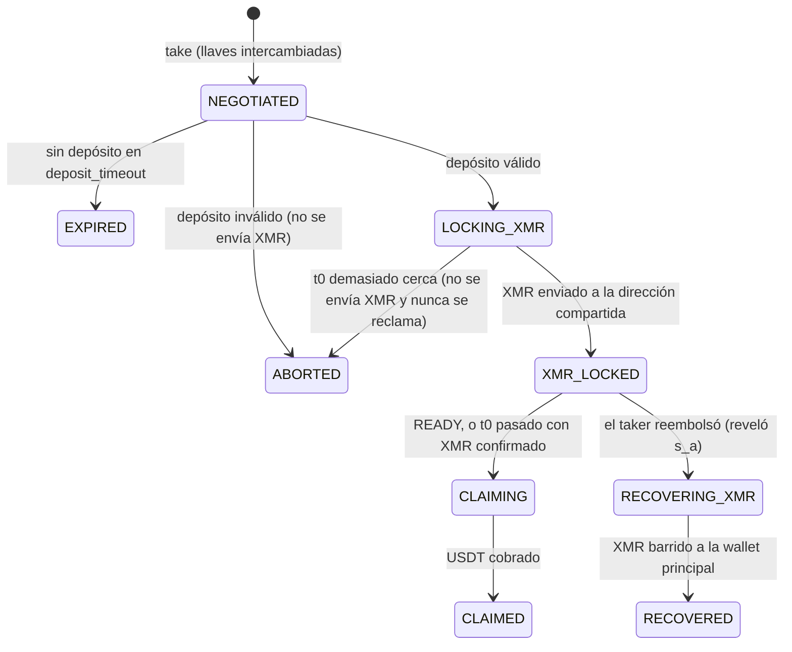

# maker — daemon del proveedor de liquidez (Fase 3)

> ⚠️ **Solo testnet, sin auditoría.** El código se niega a operar en mainnet.

**Qué hace:** cotiza swaps USDT → XMR, negocia las llaves con el taker, vigila la cadena hasta ver un depósito válido, bloquea el XMR en la dirección compartida, cobra el USDT con `claim` y, si el taker reembolsa, recupera el XMR. Guarda el estado de cada swap en SQLite para reanudar tras un reinicio.

Cualquiera puede correr su propio maker con esta guía.

## Requisitos

| Componente | Para qué |
|---|---|
| Python 3.10+ | el daemon |
| `crypto-wasm` compilado (`cargo build --release --bin xmrp2p-crypto-cli`) | la misma criptografía que usa el navegador del taker |
| `monero-wallet-rpc` (de [getmonero.org](https://www.getmonero.org/downloads/)) con una wallet stagenet con fondos | enviar y recuperar XMR |
| Una cuenta EVM de testnet con ETH para gas | enviar `claim` |
| Dirección de la `SwapFactory` y del token | `contracts/README.md` |

## Instalación

```bash
cd maker
python -m venv .venv
.venv/bin/pip install -e ".[dev]"          # en Windows: .venv\Scripts\pip
cp maker.example.toml maker.toml           # y edítalo
```

Variables de entorno (nunca en archivos del repo):

| Variable | Contenido |
|---|---|
| `MAKER_EVM_PRIVATE_KEY` | llave de la cuenta EVM del maker (**solo testnet**) |
| `MONERO_WALLET_RPC_USER` / `MONERO_WALLET_RPC_PASSWORD` | credenciales de `monero-wallet-rpc` (si usas `--rpc-login`) |
| `MONERO_MAIN_WALLET_PASSWORD` | contraseña de la wallet principal (para reabrirla tras un barrido) |

`monero-wallet-rpc` de ejemplo (stagenet):

```bash
monero-wallet-rpc --stagenet --daemon-address stagenet.xmr-tw.org:38081 \
  --rpc-bind-port 38083 --rpc-login maker:CAMBIA_ESTO --wallet-dir ./wallets --wallet-file ./wallets/maker
```

## Uso

```bash
python -m xmrp2p_maker --config maker.toml quote 50                   # cotización
python -m xmrp2p_maker --config maker.toml take 50 taker-message.json # acepta un swap (manual hasta la Fase 4)
python -m xmrp2p_maker --config maker.toml run                        # bucle: vigila y actúa
python -m xmrp2p_maker --config maker.toml status
```

Con `channel_api` en `maker.toml`, `run` publica tu oferta firmada cada `offer_refresh_seconds` (o la retira si no hay precio confiable o XMR libre) y atiende tu buzón en Cloudflare: las solicitudes de swap llegan solas y los eventos (XMR bloqueado, USDT cobrado) se envían a la sala del taker. Sin `channel_api`, `take` funciona en modo manual con el mensaje del taker en un archivo.

## Ciclo de vida de un swap



## Reglas de seguridad del daemon

1. **No envía XMR sin un depósito válido**: monto exacto, commitments correctos, el maker como `claimer`, `t0` a ≥ `min_time_to_t0` y `t1 − t0` ≥ `min_claim_window`.
2. **Nunca reclama si no bloqueó XMR.** Reclamar sin bloquear sería robarle al taker (el contrato lo permite tras `t0`; el daemon no).
3. **Sin READY, reclama tras `t0` solo con el XMR confirmado** (`xmr_confirmations`).
4. **No envía `claim` en los últimos `claim_cutoff_before_t1` segundos**: una tx fallida dejaría `s_b` público y el taker podría quedarse con el XMR y además reembolsar.
5. **Simula `claim` antes de enviarlo.**
6. **No paga dos veces**: antes de enviar XMR comprueba si ya hay un envío a esa dirección.
7. **Se niega a operar** si la fábrica no usa el token o la comisión configurados, o si la red es mainnet.

## Precio y límites

- La referencia es la **mediana** de Kraken, CoinGecko y KuCoin. Se exigen ≥ 2 fuentes y ninguna puede alejarse más de `max_divergence_bps` de la mediana; si no, no se cotiza.
- Precio del maker = referencia × (1 + `margin_bps`). La cantidad de XMR se trunca a piconero, a favor del maker.
- Límites: monto por trade, swaps simultáneos y **exposición total** de XMR en swaps abiertos. Además se exige saldo desbloqueado suficiente.

Nada de esto promete ganancias: el spread puede no cubrir la volatilidad, el gas ni las comisiones de red.

## Pruebas

```bash
cargo build --release --bin xmrp2p-crypto-cli --manifest-path ../crypto-wasm/Cargo.toml
(cd ../contracts && forge build)
.venv/bin/python -m pytest -q
```

17 pruebas (24-oct-2026): 6 unitarias (precio, almacén, puente cripto, bloqueo de mainnet) y 11 de integración **contra los contratos reales en anvil**, con el núcleo cripto real y una wallet de Monero simulada. Cubren el swap completo, el reclamo tras t0, el reembolso del taker con recuperación del XMR, los depósitos inválidos, la expiración, el reinicio sin doble envío, el corte antes de t1 y los rechazos por límites.

**No probado todavía:** contra un `monero-wallet-rpc` real en stagenet (Fase 7).

## Riesgos para quien opera un maker

- La base `maker.sqlite3` contiene las mitades de llave de cada swap: guárdala cifrada y con respaldo. Sin ella no puedes recuperar el XMR si el taker reembolsa.
- Si el daemon está caído entre `t0` y `t1`, no cobrarás; tras `t1` el taker reembolsa y deberás recuperar el XMR (el daemon lo hace al volver).
- Si el emisor de USDT congela tu dirección, configura `payout_address` para cobrar en otra.
