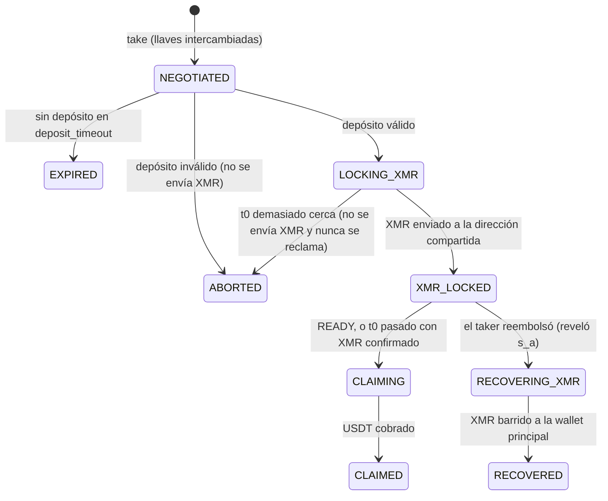

# Maker 24/7 en tu propia PC o servidor

> Funciona en testnet y con **dinero real en Arbitrum One**. El modo real exige `evm_network = "arbitrum_one"`, un tope de 100 USDT por swap y `XMRP2P_ALLOW_MAINNET=1`: ver «Modo real». El contrato está verificado con Halmos, Aderyn y Slither; sin auditoría externa todavía.

Un **maker** ofrece XMR a cambio de USDT y gana el margen que fija sobre el precio de referencia. Hay dos formas de serlo:

| | En el navegador | Con este daemon (esta guía) |
|---|---|---|
| Para quién | Cualquier persona | Quien quiere estar en línea 24/7 |
| Instalación | Ninguna: [monerop2p.app/es/maker/](https://monerop2p.app/es/maker/) | Python, Monero CLI y este programa |
| Disponibilidad | Mientras la pestaña esté abierta | Todo el tiempo, con reinicio automático |

**Qué hace el daemon:**
1. Publica tu oferta.
2. Responde las solicitudes de swap.
3. Vigila la cadena hasta ver un depósito válido.
4. Bloquea el XMR.
5. Cobra el USDT con `claim`.
6. Si el taker reembolsa, recupera tu XMR.

Guarda el estado de cada swap en SQLite y lo reanuda después de un reinicio. **Nadie más que tú tiene tus llaves**: corren en tu máquina.

**Índice:**
1. Opción A: en tu PC (Windows, Linux o macOS)
2. Opción B: en un servidor en la nube (Linux, 24/7)
3. Modo real
4. Seguridad
5. Actualizar y respaldar
6. Problemas comunes

Al final: cómo funciona por dentro.

---

## Lo que necesitas (las dos opciones)

| Qué | Para qué | Dónde se consigue |
|---|---|---|
| Python 3.10 o superior | Correr el daemon | [python.org](https://www.python.org/downloads/) o el gestor de paquetes |
| Rust (`cargo`) | Compilar el núcleo criptográfico, una sola vez | [rustup.rs](https://rustup.rs) |
| Monero CLI v0.18 o superior | `monero-wallet-rpc` (bloquear y recuperar XMR) | [getmonero.org/downloads](https://www.getmonero.org/downloads/), con la firma verificada |
| XMR de stagenet | Lo que vas a ofrecer | Un faucet de stagenet |
| Una cuenta EVM de prueba con ETH de Arbitrum Sepolia | Firmar ofertas y pagar el gas de `claim` (~0,0001 ETH por swap) | `cast wallet new` y un faucet |

Datos de la red de prueba actual (también en `docs/DESPLIEGUES.md`):

| Dato | Valor |
|---|---|
| `factory` | `0x89b330882Ea2a18aF6FE507e5832bB15ccA5542e` |
| `token` (TestUSDT) | `0x7c08fD8C4E1774f685EA03e6c50Ee9a6B20C8064` |
| `fee_bps` | `50` |
| `channel_api` | `https://api.monerop2p.app` |

---

## Opción A: en tu PC

### A1. Descarga el código y crea el entorno

```bash
git clone https://github.com/juanjobs39-cloud/xmrp2p.git
cd xmrp2p
cargo build --release --bin xmrp2p-crypto-cli --manifest-path crypto-wasm/Cargo.toml
cd maker
python -m venv .venv
.venv/bin/pip install -e .          # en Windows: .venv\Scripts\pip install -e .
```

### A2. Descarga Monero CLI y verifícalo

1. Descarga el archivo de tu sistema desde [getmonero.org/downloads](https://www.getmonero.org/downloads/) y el archivo `hashes.txt`.
2. Verifica la firma de `hashes.txt` con la llave GPG de binaryFate (guía oficial: [verificar binarios](https://www.getmonero.org/resources/user-guides/verification-allos-advanced.html)).
3. Comprueba que el SHA-256 del archivo descargado aparezca en `hashes.txt`:
   - Linux/macOS: `sha256sum monero-*.tar.bz2`
   - Windows (PowerShell): `Get-FileHash monero-*.zip`
4. Descomprímelo en una carpeta **fuera** del repositorio.

**No sigas si la firma o el hash no coinciden.**

### A3. Crea la wallet del maker (stagenet)

```bash
monero-wallet-cli --stagenet --daemon-address stagenet.xmr-tw.org:38081 --untrusted-daemon \
  --generate-new-wallet ~/.xmrp2p/wallets/maker
```

Anota la semilla de 25 palabras **en papel** y envía XMR de stagenet a la dirección que te muestra. Se desbloquea tras 10 confirmaciones (~20 min).

### A4. Arranca `monero-wallet-rpc` (solo en tu máquina)

```bash
monero-wallet-rpc --stagenet --daemon-address stagenet.xmr-tw.org:38081 --untrusted-daemon \
  --rpc-bind-ip 127.0.0.1 --rpc-bind-port 38083 --rpc-login maker:UNA_CONTRASEÑA_LARGA \
  --wallet-dir ~/.xmrp2p/wallets
```

Déjalo corriendo en su propia terminal. `--rpc-bind-ip 127.0.0.1` evita que otra máquina de tu red pueda usarlo.

### A5. Configura el maker

```bash
mkdir -p ~/.xmrp2p
cp maker.example.toml ~/.xmrp2p/maker.toml          # y edítalo
cp deploy/maker.env.example ~/.xmrp2p/maker.env     # y pon tus secretos
chmod 600 ~/.xmrp2p/maker.env                       # en Windows: guárdalo en tu carpeta de usuario
```

En `maker.toml` cambia como mínimo:
- `factory`, `token` y `fee_bps`: los valores de la tabla de arriba.
- `channel_api = "https://api.monerop2p.app"`: sin esto no publicas ofertas.
- `crypto_bin`: la ruta absoluta a `crypto-wasm/target/release/xmrp2p-crypto-cli` (en Windows termina en `.exe`).
- `db_path`: por ejemplo `~/.xmrp2p/maker.sqlite3`, fuera del repositorio.
- `payout_address` (opcional): dónde cobrar el USDT, si no quieres cobrar en la cuenta que firma.
- `[maker.price]` y `[maker.limits]`: tu margen y tus límites.

En `maker.env` pon:
- la llave de tu cuenta EVM de prueba;
- la contraseña de la RPC (la misma de `--rpc-login`);
- la contraseña de la wallet.

### A6. Prueba y arranca

```bash
.venv/bin/python -m xmrp2p_maker --config ~/.xmrp2p/maker.toml quote 20     # ¿cotiza bien?
./deploy/start-maker.sh                                                     # Linux/macOS/Git Bash
```

En Windows (PowerShell):

```powershell
powershell -ExecutionPolicy Bypass -File deploy\start-maker.ps1
```

El lanzador reinicia el daemon si se cae, por ejemplo por un corte de internet. Comprueba que tu oferta aparezca en `https://api.monerop2p.app/v1/offers?network=arbitrum_sepolia`.

**Para que tu PC no se duerma:**
- Windows: Configuración → Sistema → Energía → Suspender: Nunca.
- macOS: `caffeinate -s`.

Si la PC se apaga, el daemon reanuda al volver. Si vuelve después de `t1`, el taker ya habrá reembolsado y el daemon recupera tu XMR.

---

## Opción B: en un servidor en la nube (24/7)

Cualquier VPS Linux pequeño sirve (1 vCPU, 1–2 GB de RAM, 20 GB de disco; ~5 USD/mes). Los ejemplos son para Debian o Ubuntu con systemd.

### B1. Usuario sin privilegios y carpetas

```bash
sudo adduser --system --group --home /opt/xmrp2p xmrp2p
sudo mkdir -p /opt/xmrp2p/wallets /etc/xmrp2p /opt/monero
sudo apt install -y git python3-venv build-essential curl bzip2
curl https://sh.rustup.rs -sSf | sh          # Rust (como tu usuario, para compilar)
```

### B2. Código, núcleo cripto y entorno

```bash
sudo -u xmrp2p git clone https://github.com/juanjobs39-cloud/xmrp2p.git /opt/xmrp2p/repo
cargo build --release --bin xmrp2p-crypto-cli --manifest-path /opt/xmrp2p/repo/crypto-wasm/Cargo.toml
sudo cp /opt/xmrp2p/repo/crypto-wasm/target/release/xmrp2p-crypto-cli /opt/xmrp2p/
sudo -u xmrp2p python3 -m venv /opt/xmrp2p/repo/maker/.venv
sudo -u xmrp2p /opt/xmrp2p/repo/maker/.venv/bin/pip install -e /opt/xmrp2p/repo/maker
```

### B3. Monero CLI

Descárgalo y verifícalo como en A2. Luego copia `monero-wallet-cli` y `monero-wallet-rpc` a `/opt/monero/` y crea la wallet:

```bash
sudo -u xmrp2p /opt/monero/monero-wallet-cli --stagenet --daemon-address stagenet.xmr-tw.org:38081 \
  --untrusted-daemon --generate-new-wallet /opt/xmrp2p/wallets/maker
```

### B4. Secretos y configuración

```bash
sudo install -m 600 -o xmrp2p -g xmrp2p /opt/xmrp2p/repo/maker/deploy/maker.env.example /etc/xmrp2p/maker.env
sudo nano /etc/xmrp2p/maker.env                           # tus secretos
sudo -u xmrp2p cp /opt/xmrp2p/repo/maker/maker.example.toml /opt/xmrp2p/maker.toml
sudo -u xmrp2p nano /opt/xmrp2p/maker.toml                # como en A5
```

En el servidor usa estas rutas en `maker.toml`:
- `crypto_bin = "/opt/xmrp2p/xmrp2p-crypto-cli"`
- `db_path = "/opt/xmrp2p/maker.sqlite3"`

### B5. Servicios con reinicio automático

```bash
sudo cp /opt/xmrp2p/repo/maker/deploy/monero-wallet-rpc.service /etc/systemd/system/
sudo cp /opt/xmrp2p/repo/maker/deploy/xmrp2p-maker.service /etc/systemd/system/
sudo systemctl daemon-reload
sudo systemctl enable --now monero-wallet-rpc xmrp2p-maker
journalctl -u xmrp2p-maker -f                              # ver qué hace
```

Si cualquiera de los dos se cae, systemd lo reinicia (`Restart=always`). También arrancan solos tras reiniciar el servidor.

### B6. Firewall

El maker **no necesita puertos de entrada**: se conecta él hacia afuera. Deja abierto solo SSH:

```bash
sudo ufw default deny incoming && sudo ufw allow OpenSSH && sudo ufw enable
```

La RPC de la wallet escucha solo en `127.0.0.1`. Nunca la expongas.

---

## Modo real

> ⚠️ Dinero real **sin auditoría externa**. Arriesga solo lo que puedas perder.

El daemon acepta `monero_network = "mainnet"` solo si se cumplen **las tres** condiciones; si falta alguna, se niega a arrancar y dice cuál:

1. `evm_network = "arbitrum_one"`;
2. `[maker.limits] max_usdt` ≤ 100 (el contrato de la beta también rechaza más de 100 USDT por swap);
3. la variable de entorno `XMRP2P_ALLOW_MAINNET=1` (en `maker.env` o en la terminal).

Las fallas de prueba (`XMRP2P_TEST_FAULTS`) siguen prohibidas en mainnet.

Ejemplo de `maker.toml` para Arbitrum One:

```toml
[maker]
evm_rpc = "https://arb1.arbitrum.io/rpc"                  # mejor un RPC propio o de pago
factory = "0x0000000000000000000000000000000000000000"   # SwapFactory de la beta: se llena tras el despliegue
token = "0xFd086bC7CD5C481DCC9C85ebE478A1C0b69FCbb9"     # USD₮0 en Arbitrum One
fee_bps = 50                                              # debe coincidir con la fábrica

monero_network = "mainnet"
monero_wallet_rpc = "http://127.0.0.1:18083/json_rpc"     # monero-wallet-rpc SIN --stagenet
monero_main_wallet = "maker"

db_path = "maker.sqlite3"
crypto_bin = "../crypto-wasm/target/release/xmrp2p-crypto-cli"
channel_api = "https://api.monerop2p.app"
evm_network = "arbitrum_one"

[maker.limits]
min_usdt = 10
max_usdt = 100               # obligatorio ≤ 100 en la beta
max_exposure_xmr = 1
max_concurrent = 2
```

Diferencias con testnet:
- Crea una wallet de Monero **nueva** de mainnet (sin `--stagenet`) y arranca `monero-wallet-rpc` sin `--stagenet`, idealmente contra tu propio `monerod`.
- La cuenta EVM necesita ETH real en Arbitrum One para el gas.
- Empieza con montos pequeños y respalda `maker.sqlite3` antes de cada swap.

## Seguridad

- **Sin custodia:** tus llaves (EVM y Monero) solo existen en tu máquina. Ni MoneroP2P ni el backend las ven.
- **Secretos fuera del repositorio y con permisos 600:**
  - `maker.env`, `maker.toml` y `maker.sqlite3` van fuera de la carpeta de Git;
  - nunca pegues la llave en la terminal ni en un chat.
- **La base SQLite contiene las mitades de llave de cada swap.** Sin ella no puedes recuperar el XMR si un taker reembolsa. Respáldala, cifrada.
- **Contraseña de la RPC en la lista de procesos:** con `--rpc-login`, la contraseña se ve en `ps` para otros usuarios del mismo sistema. En un servidor solo tuyo no importa. Si lo compartes, usa `--config-file` con permisos 600.
- **Nodo propio (recomendado):** un nodo público puede mentirte sobre la cadena. Con `monerod --stagenet` propio, cambia `--daemon-address` a `127.0.0.1:38081` y quita `--untrusted-daemon`.
- **Mainnet solo en modo beta:** el daemon se niega a mainnet salvo con las tres condiciones de «Modo real».
- **Si el servidor se cae a mitad de un swap:**
  - Si vuelve antes de `t1`, el daemon reanuda desde SQLite y cobra.
  - Si vuelve después de `t1`, el taker ya reembolsó y el daemon recupera tu XMR con el secreto que reveló el reembolso.
  - En ningún caso pierdes el XMR mientras conserves la base SQLite y la wallet.

## Actualizar y respaldar

```bash
# Actualizar (en el servidor)
sudo systemctl stop xmrp2p-maker
sudo -u xmrp2p git -C /opt/xmrp2p/repo pull
sudo -u xmrp2p /opt/xmrp2p/repo/maker/.venv/bin/pip install -e /opt/xmrp2p/repo/maker
sudo systemctl start xmrp2p-maker

# Respaldo cifrado (base de datos + wallet)
sudo tar czf - /opt/xmrp2p/maker.sqlite3 /opt/xmrp2p/wallets | gpg -c > respaldo-maker-$(date +%F).tar.gz.gpg
```

Para la wallet basta con la semilla de 25 palabras. **La base SQLite no se puede reconstruir**: respáldala cada vez que haya swaps en curso.

## Problemas comunes

| Síntoma | Causa probable | Qué hacer |
|---|---|---|
| Tu oferta no aparece | Falta `channel_api`, no hay XMR desbloqueado o no hay precio | Mira el log; espera 10 confirmaciones tras recibir XMR |
| `Falta MAKER_EVM_PRIVATE_KEY` | No se cargó `maker.env` | Revisa `EnvironmentFile` o la ruta del lanzador |
| `la fábrica cobra … bps` | `fee_bps` no coincide | Usa los valores de la tabla de arriba |
| `el maker no tiene XMR disponible suficiente` | El cambio de un envío anterior sigue bloqueado (~20 min) | Espera, o fondea la wallet con varias salidas |
| `buzón desconectado` en el log | Corte de red | Se reconecta solo; si persiste, revisa la salida a internet |
| `claim` falla por gas | Sin ETH en la cuenta del maker | Envía ETH de Arbitrum Sepolia a esa cuenta |

---

# Cómo funciona por dentro

## Comandos

```bash
python -m xmrp2p_maker --config maker.toml quote 50                   # cotización
python -m xmrp2p_maker --config maker.toml take 50 taker-message.json # acepta un swap a mano (sin channel_api)
python -m xmrp2p_maker --config maker.toml run                        # bucle: vigila y actúa
python -m xmrp2p_maker --config maker.toml status
```

Con `channel_api` en `maker.toml`, `run` publica tu oferta firmada cada `offer_refresh_seconds` (o la retira si no hay precio confiable o XMR libre) y atiende tu buzón en Cloudflare: las solicitudes de swap llegan solas y los eventos (XMR bloqueado, USDT cobrado) se envían a la sala del taker. Sin `channel_api`, `take` funciona en modo manual con el mensaje del taker en un archivo.

## Ciclo de vida de un swap



## Reglas de seguridad del daemon

1. **No envía XMR sin un depósito válido**: monto exacto, commitments correctos, el maker como `claimer`, `t0` a ≥ `min_time_to_t0` y `t1 − t0` ≥ `min_claim_window`.
2. **Nunca reclama si no bloqueó XMR.** Reclamar sin bloquear sería robarle al taker (el contrato lo permite tras `t0`; el daemon no).
3. **Sin READY, reclama tras `t0` solo con el XMR confirmado** (`xmr_confirmations`).
4. **No envía `claim` en los últimos `claim_cutoff_before_t1` segundos**: una tx fallida dejaría `s_b` público y el taker podría quedarse con el XMR y además reembolsar.
5. **Simula `claim` antes de enviarlo.**
6. **No paga dos veces**: antes de enviar XMR comprueba si ya hay un envío a esa dirección.
7. **Se niega a operar** si la fábrica no usa el token o la comisión configurados, o si la red es mainnet sin las condiciones del modo real (beta).

## Precio y límites

- La referencia es la **mediana** de Kraken, CoinGecko y KuCoin. Se exigen ≥ 2 fuentes y ninguna puede alejarse más de `max_divergence_bps` de la mediana; si no, no se cotiza.
- Precio del maker = referencia × (1 + `margin_bps`). La cantidad de XMR se trunca a piconero, a favor del maker.
- Límites: monto por trade, swaps simultáneos y **exposición total** de XMR en swaps abiertos. Además se exige saldo desbloqueado suficiente.

Nada de esto promete ganancias: el spread puede no cubrir la volatilidad, el gas ni las comisiones de red.

## Pruebas

```bash
cargo build --release --bin xmrp2p-crypto-cli --manifest-path ../crypto-wasm/Cargo.toml
(cd ../contracts && forge build)
.venv/bin/python -m pytest -q
```

30 pruebas (26-oct-2026): 16 unitarias (precio, almacén, puente cripto, condiciones del modo real en mainnet, fallas de prueba prohibidas en mainnet) y 14 de integración **contra los contratos reales en anvil**, con el núcleo cripto real y una wallet de Monero simulada. Cubren el swap completo, el reclamo tras t0, el reembolso del taker con recuperación del XMR, los depósitos inválidos, la expiración, el reinicio sin doble envío, el corte antes de t1 y los rechazos por límites.

**Probado en testnet (Fase 7):** 10 casos de punta a punta con `monero-wallet-rpc` real en stagenet y un swap manual con MetaMask (`docs/PRUEBAS.md`).

## Riesgos para quien opera un maker

- La base `maker.sqlite3` contiene las mitades de llave de cada swap: guárdala cifrada y con respaldo. Sin ella no puedes recuperar el XMR si el taker reembolsa.
- Si el daemon está caído entre `t0` y `t1`, no cobrarás; tras `t1` el taker reembolsa y deberás recuperar el XMR (el daemon lo hace al volver).
- Si el emisor de USDT congela tu dirección, configura `payout_address` para cobrar en otra.
